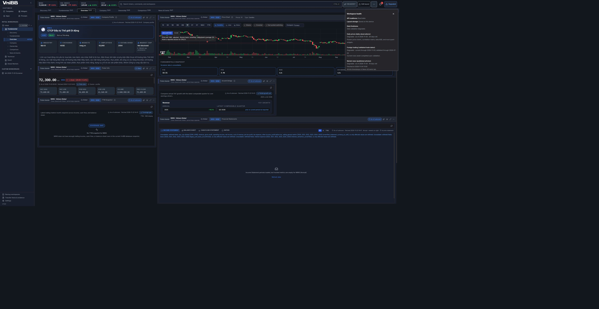
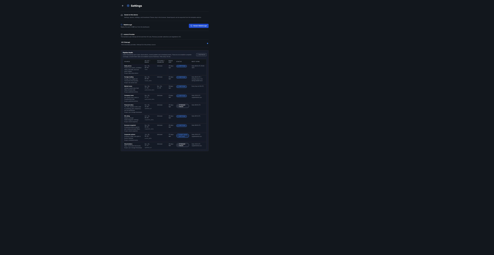

# VNIBB database-focused QA evidence, 23 November 2026

This evidence accompanies GitHub issues #274, #172, #111 and the source-confirmed membership defect #286.

## Scope and provenance

- Live browser observations: approximately **14:41–14:48 ICT**, 23 November 2026.
- Source reviewed: `df6a6d6f35c1e5bcee60d67b79c81c351530d425`.
- The serving frontend/API revision was not established.
- The screenshots are original browser captures. No image content was altered.
- No production database was connected, scanned or changed in this pass.
- Historical database counts below are a separately dated recorded census, not new measurements.

## Screenshot 1: workspace freshness and MWG coverage



Page: https://web.vnibb.xyz/dashboard?dashboard=default-fundamental&tab=tab-default-fundamental-overview&symbol=MWG

The health panel reports daily observations dated **3 November** (20 days old), foreign rows current through **3 November** but validated only through **2 July**, and market news dated **4 November** (19 days old). MWG is quoted at 72,300 VND as of 3 November; recent fetch time is separately shown. TTM is unavailable, and financial statement values are withheld because provenance/units are unverified.

These are visible application statements, not raw-row verification. A fresh fetch does not establish fresh source data.

## Screenshot 2: pipeline freshness by dataset



Page: https://web.vnibb.xyz/settings

| Dataset | Displayed basis | Basis type | Displayed age/status |
|---|---|---|---|
| Daily prices | 3 Nov, 00:00 | daily observation time | 20 days / Critical |
| Foreign trading | 3 Nov, 00:00 | raw stored trade date | 20 days / Critical |
| Market news | 4 Nov, 17:50 | published date | 19 days / Critical |
| Company news | 2 Nov, 17:11 | published date | 21 days / Critical |
| Financial ratios | 3 Nov, 18:00 | storage updated_at | 20 days / Storage fresh |
| RS rating | 14 Oct, 00:00 | stored snapshot date | 40 days / Critical |
| Screener snapshot | 3 Nov, 00:00 | stored snapshot date | 20 days / Critical |
| Corporate actions | 5 Jun, 00:00 | scheduled event date | 171 days / Event date critical |
| Shareholders | 3 Nov, 11:21 | storage updated_at | 20 days / Storage fresh |

Event-date age is not ingestion age. Storage freshness is not source freshness. The displayed schedule is not evidence that a job actually ran. Do not combine these into one uniform staleness percentage.

## Exact-source synthetic reproductions

`reproduce_audit_blind_spots.py` parses the pinned `apps/api/vnibb/services/data_quality.py`, verifies Git blob `9b36b6734964842dc7ca219fbcf3ef096988294d`, and executes only the Mongo status helper and two history-count assignments. It does not import the application or invoke its audit runner.

From this evidence checkout:

```bash
python3 docs/qa/evidence/2026-11-23-db/reproduce_audit_blind_spots.py \
  --source apps/api/vnibb/services/data_quality.py \
  --output /tmp/vnibb-audit-blind-spots-results.json
```

Six cases were executed successfully; outputs are in `audit_blind_spots_results.json`.

1. One clean returned symbol out of 20 requested yields Mongo subreport `ok`. Empty and invalid-OHLCV controls return warning and failed respectively. This helper does not classify partial coverage.
2. One observation from 2020, or only 2020/2026 endpoints, counts as `top_with_5y_prices = 1`. That metric tests an old minimum date, not continuous five-year coverage. The actual threshold includes the source's 30-day allowance and is 23 December 2021 for the fixed audit date.

These are synthetic source-expression probes, not production census results or executed Mongo/SQL aggregation tests.

## Dated production census reference

[#171, census captured 19 Nov 2026 11:11:33–41 UTC](https://github.com/Kohnnn/vnibb/issues/171#issuecomment-7007502440) recorded:

- 1,757 application-active SQL members; 1,719 with retained SQL prices and 1,720 with retained Mongo EOD.
- 1,419,653 retained PostgreSQL price rows and 329,966 screener snapshots.
- For the expected 19 November session: current SQL rows, current Mongo EOD rows, received envelopes and admitted screener members all zero.

Application membership is not independently certified exchange eligibility. The capture had separate cross-store transaction windows. New live counts require a new bounded read-only census.

## Related issue

[#286](https://github.com/Kohnnn/vnibb/issues/286) traces how five matching empty-history errors can set a stock inactive and omit it from later default ingestion. Its proposed database regression remains unexecuted. The screenshots do not prove this mechanism caused the present outage.
